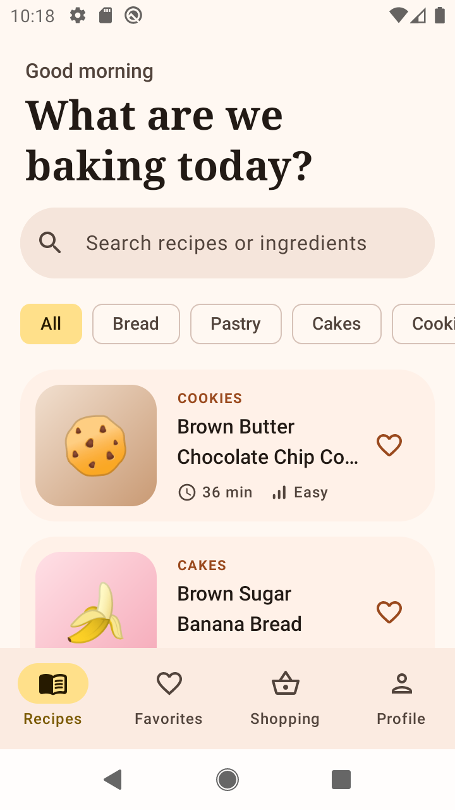
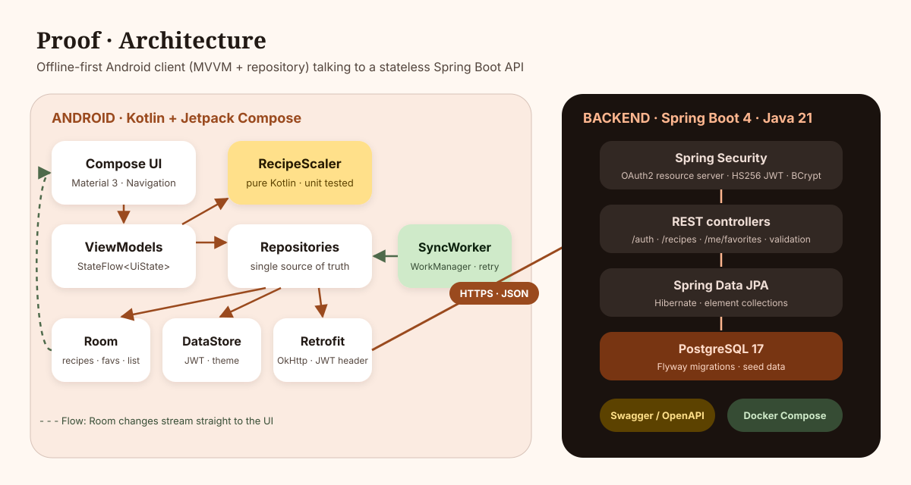
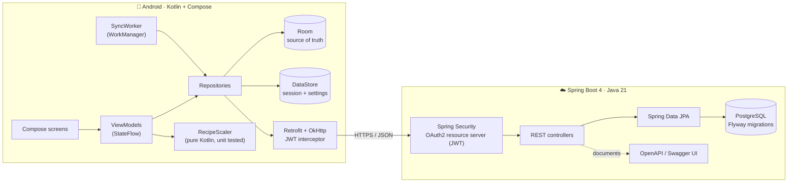

<div align="center">


# Proof

**A baker's recipe companion: smart scaling, step-by-step timers, and an offline-first shopping list.**

Kotlin · Jetpack Compose · Room · Retrofit · WorkManager · Spring Boot 4 · PostgreSQL · JWT

[](https://github.com/OWNER/proof/actions/workflows/android.yml)
[](https://github.com/OWNER/proof/actions/workflows/backend.yml)
[](https://github.com/OWNER/proof/releases/latest)

</div>

---

> *Proofing* is the last rise before the bake, the step where good dough becomes great bread.
> Proof aims to do the same for your recipes.

You find a sourdough recipe for two loaves but want to make three. Proof rescales every ingredient
in metric, keeps your baker's percentages intact, walks you through each step with built-in timers
that ping you even when the phone is locked, and adds everything you need to a shopping list that
works in a basement supermarket with zero signal.

## Screenshots

| Recipes | Smart scaler | Cooking mode | Shopping list | Dark mode |
|:---:|:---:|:---:|:---:|:---:|
|  |  |  |  |  |

## Features

- **Smart scaler**: change the batch size and every amount updates live. Results are normalised to the
  friendliest metric unit (1250 g → 1.25 kg, 6 tbsp → 90 ml), small amounts keep half-gram precision
  for yeast and salt, and eggs never drop below half an egg.
- **Baker's percentages**: one toggle shows each ingredient relative to total flour. They stay constant
  however you scale, which is how professional bakers check a formula.
- **Cooking mode**: a swipeable step pager with large type, built-in timers, several timers running at once
  (preheat the oven while the dough rests), the screen kept awake, and an `AlarmManager`-backed
  notification that still fires if the app is killed during a four-hour bulk ferment.
- **Offline first**: Room is the single source of truth. The app ships with seed recipes, so it works on
  first launch without a server.
- **Favorites that sync**: favourite as a guest, sign in later and your favourites upload. Changes made
  offline are queued and replayed by WorkManager when you're back online.
- **Shopping list**: add a scaled recipe in one tap. The same ingredient from different recipes merges
  into one line (200 g butter + 175 g butter = 375 g butter).
- **Search and filter** by title, description or ingredient ("what can I make with buttermilk?").
- **Login and sync** with JWT auth against a Spring Boot API.
- **Light and dark themes** with a warm bakery palette: flour, crust, butter, sage and dark rye.

## Architecture





**Android (MVVM + repository)**

| Layer | What lives there |
|---|---|
| `ui/` | Compose screens, one `ViewModel` per screen exposing a single `StateFlow<UiState>`. Type-safe Compose Navigation routes. |
| `domain/` | Plain Kotlin models and the **scaling engine** (`RecipeScaler`, `QuantityFormatter`), with no Android imports, so it is 100% unit-testable. |
| `data/` | `RecipeRepository`, `AuthRepository`, `ShoppingRepository`, `SettingsRepository`. Room DAOs, Retrofit API, DataStore session, `SyncWorker`. |
| `di/` | `AppContainer`: hand-written dependency injection. No magic, easy to explain, easy to fake in tests. |

**How offline sync works**

1. The UI only ever observes Room `Flow`s. The network never talks to the UI directly.
2. Tapping ♥ writes `FavoriteEntity(isFavorite, pendingSync = true)` locally, so the UI updates instantly, and enqueues a `SyncWorker`.
3. The worker waits for connectivity, **pushes** pending changes (`PUT` / `DELETE`, both idempotent so retries are safe), then **pulls** the server's set.
4. On merge the server wins for rows without local pending changes, so a favourite added on your tablet shows up on your phone.
5. A periodic sync runs every 6 hours, and exponential backoff handles a flaky backend.

**Backend**

- `POST /api/auth/register`, `POST /api/auth/login`: BCrypt password hashes, HS256 JWTs issued with Spring Security's `JwtEncoder`.
- `GET /api/recipes?q=&category=`, `GET /api/recipes/{id}`: public catalogue, searches ingredient names too.
- `GET | PUT | DELETE /api/me/favorites/{id}`: per-user favourites.
- `GET /api/me`: current user.
- Uniform error body `{status, error, message, timestamp}`, Bean Validation on requests, Flyway-managed schema, a seed loader, and actuator health.
- Full interactive docs at **`/swagger-ui.html`**.

## Tech stack

| | |
|---|---|
| **Mobile** | Kotlin 2.2, Jetpack Compose (Material 3), Navigation Compose (type-safe routes), Room, DataStore, WorkManager, Retrofit 3, OkHttp 5, kotlinx.serialization, AlarmManager + notifications |
| **Backend** | Java 21, Spring Boot 4.1, Spring Security (OAuth2 resource server / JWT), Spring Data JPA, Flyway, PostgreSQL 17, springdoc-openapi |
| **Quality** | JUnit unit tests for the scaling engine, MockMvc integration tests for every endpoint, Android Lint |
| **DevOps** | GitHub Actions (Android build + tests, backend tests + Docker image, tag → signed APK on GitHub Releases), Docker Compose |

## Getting started

### 1. Run the backend

```bash
docker compose up --build
```

API at <http://localhost:8080>, Swagger UI at <http://localhost:8080/swagger-ui.html>.
Ten recipes are seeded automatically.

<details>
<summary>Without Docker</summary>

Start PostgreSQL with a `proof` database and user, then:

```bash
cd backend
./gradlew bootRun
```

Configure with `DATABASE_URL`, `DATABASE_USER`, `DATABASE_PASSWORD` and `PROOF_JWT_SECRET` (32+ bytes).
</details>

### 2. Run the app

Open `android/` in Android Studio and press ▶. The emulator reaches your machine at `10.0.2.2:8080`,
which is the default. On a real device:

```bash
cd android
./gradlew installDebug -PapiBaseUrl=http://192.168.1.20:8080/
```

> The app is fully usable without the backend: recipes, scaling, timers and the shopping list all work
> offline. You only need the server for accounts and cross-device sync.

### 3. Run the tests

```bash
cd android && ./gradlew testDebugUnitTest   # scaling engine, formatter, timers
cd backend && ./gradlew test                # auth, recipes, favourites, OpenAPI
```

## Releases

Push a tag and GitHub Actions builds a release APK and attaches it to a GitHub Release:

```bash
git tag v1.0.0 && git push origin v1.0.0
```

To sign with your own key, add the repository secrets `PROOF_KEYSTORE_BASE64`, `PROOF_KEYSTORE_PASSWORD`,
`PROOF_KEY_ALIAS` and `PROOF_KEY_PASSWORD`. Set the repository variable `PROOF_API_BASE_URL` to point the
release build at a deployed API.

## Project structure

```
proof/
├── android/                     Kotlin + Jetpack Compose app
│   └── app/src/
│       ├── main/java/com/proofapp/android/
│       │   ├── domain/          models + scaling engine (pure Kotlin)
│       │   ├── data/            Room, Retrofit, DataStore, repositories, sync
│       │   ├── di/              AppContainer
│       │   └── ui/              screens, ViewModels, theme, navigation
│       └── test/                unit tests
├── backend/                     Spring Boot API
│   └── src/main/
│       ├── java/com/proofapp/api/  auth, recipe, favorite, user, config
│       └── resources/           application.yml, Flyway migrations, seed data
├── docs/                        architecture, screenshots, LinkedIn post drafts
├── .github/workflows/           CI and release pipelines
└── docker-compose.yml
```

## Roadmap

- [ ] Create and edit your own recipes (with ownership on the API)
- [ ] Imperial ↔ metric toggle
- [ ] Scale by available flour ("I only have 700 g, what can I make?")
- [ ] Wear OS timer companion
- [ ] Deploy the API (Fly.io / Render) and point releases at it

## License

[MIT](LICENSE)
